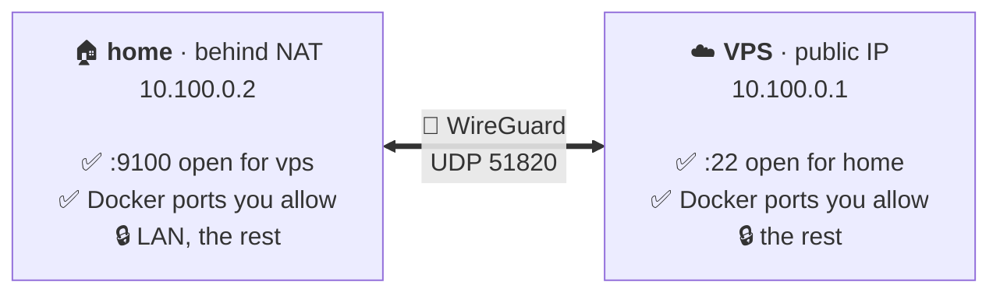

<div align="center">


**A private, default-deny WireGuard link between two Linux servers: one command per step, nothing open by accident.**

[](https://github.com/nikitakiselev/meshly/actions/workflows/ci.yml)
[](https://github.com/nikitakiselev/meshly/releases)
[](LICENSE)
[](go.mod)

**English** · [Русский](README.ru.md)

</div>

meshly joins Linux servers into one private network: they reach each other at
`10.100.0.1`, `10.100.0.2` and so on, as if they were on the same local network.
The connection is encrypted (WireGuard), and everything is closed by default: you
decide which ports one server may connect to on another.

For example, you have a VPS with a public IP and a homelab behind your home
router, and you want them to talk to each other securely: SSH, a database,
monitoring, backups. meshly connects them in a few commands, without config files
and without setting up WireGuard and a firewall by hand. Only what you allow gets
through, for example `meshly allow 22/tcp from home`. More servers join the VPS the
same way, each with a tunnel to it; the servers that joined do not reach each other.



> [!NOTE]
> meshly is at an early stage (0.0.x). The CLI and the on-disk formats may still change between minor
> versions. Read the [threat model](docs/threat-model.md) and [what is not verified yet](docs/testing.md#not-verified)
> before you depend on it.

## Contents

- [Features](#features)
- [Requirements](#requirements)
- [Install](#install)
- [Quick start](#quick-start)
- [Everyday use](#everyday-use)
- [How it works](#how-it-works)
- [Security](#security)
- [Documentation](#documentation)
- [FAQ](#faq)
- [Contributing](#contributing)
- [License](#license)

## Features

- **Default deny.** A peer can reach only the ports you list with `meshly allow`. A rule applies only to traffic
  coming in through the tunnel, in one direction (peer → this node). `meshly deny` also cuts connections that are
  already established.
- **No accidental exposure.** No access to the LAN behind a server, nothing forwarded from the LAN into the tunnel,
  and no IPv6 inside the VPN. A Docker container is like a program on the server: a port it publishes opens only
  with `meshly allow`, and containers reach the other servers only where they allow. Spoofed sources are dropped.
- **One VPS, several servers.** Every server joins the one that created the network and gets the next address. Rules
  name each server, so the VPS opens a port to one of them and not to the others, and the servers that joined do not
  reach each other.
- **Secure pairing without a server.** `meshly invite` prints a one-time code, and `meshly join` on the new server
  asks for it. The servers exchange their keys through the WireGuard port that is already open, so nothing new is
  reachable from the internet or by other users of the server, even while the invite waits. The code works once,
  expires after 10 minutes and never passes through command-line arguments.
- **Safe changes.** Every change is a journaled transaction with verification and rollback. If a failure leaves the
  tunnel in an unknown state, meshly closes it (*safe mode*) rather than leaving it open. An operation interrupted by
  a crash or power loss is finished or rolled back on the next start. Safe mode retains pending access removals,
  including when their configuration could not be saved, so recovery cannot silently restore an old allow rule.
- **Works with your firewall.** meshly owns one nftables table, `inet meshly`, and replaces it atomically. With UFW or
  iptables rules, meshly keeps one rule at the top of their `INPUT` and `OUTPUT` chains (and `FORWARD` on a Docker
  host) that lets through only what meshly allowed; no `ufw allow` is needed. fail2ban needs nothing either. It
  touches nothing else. Unsupported setups (firewalld, iptables-legacy rules, native nftables drop chains without the
  integration rule) are detected *before* any change.
- **Survives the real world.** NAT and idle timeouts (keepalive on both sides), VPS restarts (instant re-handshake
  from learned endpoints), reboots, Docker restarts, `systemctl restart nftables` and `flush ruleset`. New Docker
  networks work within seconds. A one-minute integrity check repairs drift.
- **Diagnosable.** `meshly status` and `meshly doctor` print human-readable reports, or stable JSON with `--json`.
  Exit codes are stable, and every finding says whether it was observed or inferred.
- **Signed self-upgrade.** `meshly upgrade` installs the latest GitHub release after checking an Ed25519 signature and
  SHA-256. It restarts the service and rolls back if the new version does not start. Release builds are
  reproducible.

## Requirements

| | |
|---|---|
| OS | Linux with systemd. Tested on **Debian 12** and **Ubuntu 24.04** |
| Architecture | `amd64`, `arm64` |
| Kernel | WireGuard in the kernel (built-in or module; any 5.6+ distribution kernel) |
| Firewall | nftables ≥ 1.0.6 (`/usr/sbin/nft`) is required. Host firewall: none, UFW, iptables rules (`iptables-nft`, the default backend) or a native nftables ruleset, with or without fail2ban. Not supported: firewalld, iptables-legacy rules |
| Network | One node needs a public UDP port (default `51820`) that the other nodes can reach |
| Tools | `curl` or `wget`, `openssl`, `sha256sum` (installer only) |

meshly runs as root (`sudo`). It installs no packages and changes no global sysctl. It does not manage cloud
firewalls or security groups.

## Install

Run on **every** server:

```sh
curl -fsSL https://github.com/nikitakiselev/meshly/releases/latest/download/install.sh | sudo sh
```

The installer downloads the binary for your architecture and verifies the Ed25519 signature of `SHA256SUMS` with
the release key built into the script. It then checks the binary's SHA-256 and installs it as
`/usr/local/bin/meshly`. It makes no other change: the network, firewall and systemd setup is done later by
`meshly init` and `meshly join`.

<details>
<summary>Install a specific version, inspect the installer first, or verify by hand</summary>

```sh
# a specific version
curl -fsSL https://github.com/nikitakiselev/meshly/releases/latest/download/install.sh | sudo MESHLY_VERSION=0.0.1 sh

# read the script before running it
curl -fsSLO https://github.com/nikitakiselev/meshly/releases/latest/download/install.sh
less install.sh && sudo sh install.sh
```

Manual verification uses the public key from [`release-key.pub`](release-key.pub):

```sh
V=0.0.1; A=amd64   # or arm64
base=https://github.com/nikitakiselev/meshly/releases/download/v$V
curl -fsSLO $base/SHA256SUMS -O $base/SHA256SUMS.sig -O $base/meshly-$V-linux-$A
printf '%s\n' '-----BEGIN PUBLIC KEY-----' "MCowBQYDK2VwAyEA$(curl -fsSL https://raw.githubusercontent.com/nikitakiselev/meshly/main/release-key.pub)" '-----END PUBLIC KEY-----' > meshly-release.pem
{ printf 'meshly-release/1\000'; cat SHA256SUMS; } > msg
openssl base64 -d -A -in SHA256SUMS.sig -out sig
openssl pkeyutl -verify -pubin -inkey meshly-release.pem -rawin -in msg -sigfile sig
sha256sum --ignore-missing -c SHA256SUMS
sudo install -m 0755 meshly-$V-linux-$A /usr/local/bin/meshly
```

Every release is also rebuilt from the tagged source by the
[Verify release](.github/workflows/release-verify.yml) workflow, which checks that the published binaries match.
</details>

## Quick start

The example uses two servers:

- **vps**: public IP `203.0.113.10`. Allow inbound **UDP 51820** in your cloud firewall.
- **home**: behind NAT; it reaches the VPS on that UDP port.

`meshly invite` on vps prints a code, and you paste it into `meshly join` on home. Copy the code from your own
terminal: it works once and expires after 10 minutes. The samples below leave out the steps that each command lists
while it applies them.

**1. On vps:** create the network.

```console
admin@vps:~$ sudo meshly init homelab --name vps
Network "homelab" created.
  this node:    vps  10.100.0.1 on meshly0
  endpoint:     203.0.113.10:51820, detected on eth0 (to change: meshly set endpoint IP)
                UDP 51820 must be reachable; cloud firewalls are not managed by meshly
  firewall:     profile none; all inbound VPN traffic is denied until `meshly allow`
  public key:   bWcWhZaUNdCDGVVlpXq8o/ep9g9jtumd2jC7Zsju9C4=

Next: run `sudo meshly invite` on this node and `sudo meshly join` on the node to add, once for each node.
```

You do not need to look up the VPS address: meshly finds the public IP on its network interface and uses the standard
WireGuard port 51820. Some clouds (AWS, GCP) give the server only a private address and map the public one from outside;
there meshly reports that it found none, and you pass the address yourself: `--endpoint 203.0.113.10`.

**2. On vps:** open an invite. It prints a code and waits.

```console
admin@vps:~$ sudo meshly invite
Waiting for a node to join network "homelab" until 20:40 UTC (10 minutes). Ctrl+C cancels.
On the new node run `sudo meshly join` and paste this code:

m2atfqa4ikzjwgpbrtj3phaxmxkj7mzkcutbejgrbusyvju73zukbjrppgtl6q4yakmqaaegdk2uxkamwtchm7oqnrrkialyu6jp4zrk7wlzcjm

Node "home" (10.100.0.2) joined. The invite is closed.
```

The last line appears once home has joined in step 3. The invite then closes by itself, and the code no longer
works. While it waits, nothing new is reachable from the internet: the servers talk through the WireGuard port.

**3. On home:** join, and paste the code when asked.

```console
admin@home:~$ sudo meshly join
Invite code: m2atfqa4ikzjwgpbrtj3phaxmxkj7mzkcutbejgrbusyvju73zukbjrppgtl6q4yakmqaaegdk2uxkamwtchm7oqnrrkialyu6jp4zrk7wlzcjm
Connecting to 203.0.113.10:51820...
Joined network "homelab" as "home" (10.100.0.2).
  peer:  vps 10.100.0.1 via 203.0.113.10:51820
Inbound VPN traffic to this node is denied until you run `meshly allow` here.
```

The node is named after its host name (here `home`); choose another name with `--name`. If home cannot reach the
VPS on UDP 51820, `join` says so after 30 seconds and changes nothing.

**4. Allow what each side needs.** Rules are per node: a rule opens a port on the node where you run it.

```sh
admin@vps:~$  sudo meshly allow 22/tcp from home     # home may SSH to vps at 10.100.0.1
admin@home:~$ sudo meshly allow 9100/tcp from vps    # vps may scrape node_exporter on home at 10.100.0.2
admin@home:~$ sudo meshly allow ping from vps
```

**5. Check.**

```sh
sudo meshly nodes      # the nodes of the network and whether they are connected
sudo meshly ping home  # on vps: ping through the tunnel; if home does not answer, says why
sudo meshly status     # configuration, interface, handshake, traffic, rules, drift
sudo meshly doctor     # every check with a verdict; exit 0 = no problems
```

**6. Add more servers.** Run `sudo meshly invite` on vps again and `sudo meshly join` on the new server, for example
office. It gets the next address, `10.100.0.3`, and a tunnel to vps. Home keeps working meanwhile. Rules name the
server, so `sudo meshly allow 9108/tcp from office` on vps opens that port to office and not to home. Office and home
do not reach each other.

The link starts at boot via `meshly.service`. For scripts, `meshly join` also reads the code from stdin: see
[pairing from a script](docs/cli.md#pairing-from-a-script).

## Everyday use

| Task | Command |
|---|---|
| Open a service to the peer | `sudo meshly allow 5432/tcp from home` |
| Close it (cuts established connections too) | `sudo meshly deny 5432/tcp from home` |
| List rules | `sudo meshly rules` |
| Who is in the network, does the link work | `sudo meshly nodes`, `sudo meshly ping home` |
| Add a server | `sudo meshly invite` (on vps), `sudo meshly join` (on the new server) |
| Health and diagnostics | `sudo meshly status`, `sudo meshly doctor`, `sudo meshly doctor --probe 22/tcp` |
| Stop or start the link (stop survives reboot) | `sudo meshly stop`, `sudo meshly start`, `sudo meshly restart` |
| VPS changed its IP | `sudo meshly set peer-endpoint vps 198.51.100.7` (on home) |
| Path with a smaller MTU | `sudo meshly set mtu 1380` (on every node) |
| Who changed what | `sudo meshly logs` |
| Upgrade to the latest release | `sudo meshly upgrade` (`--check` to only look) |
| Remove a server from the network | `sudo meshly revoke home` (on vps) |
| Remove meshly from a node | `sudo meshly reset` |

`init`, `allow`, `deny`, `revoke`, `start`, `stop` and `set` accept `--dry-run`. Run `meshly help <command>` for
details. The full reference, including exit codes and JSON schemas, is in [docs/cli.md](docs/cli.md).

## How it works

- **Kernel WireGuard** is configured over netlink. There is no `wg-quick`, no shell and no `PostUp`/`PostDown`
  hooks: meshly runs no user-supplied commands.
- **One nftables table**, `inet meshly`, holds the entire policy. It is replaced atomically and carries an ownership
  marker. Foreign tables are only read, to detect conflicts. With a native nftables ruleset that drops by default,
  you add one integration rule to your chain, and `meshly doctor` prints it for you
  ([firewall profiles](docs/firewall.md)).
- **Transactions**: each change is a plan of steps that is journaled, applied, verified and then committed. Failure
  rolls back, and an unknown state ends in safe mode (the tunnel closed). [Architecture](docs/architecture.md).
- **systemd**: `meshly.service` (oneshot) brings the link up at boot after the system firewall. `meshly-check.timer`
  re-applies the policy if something removed it, and `meshly-watch.service` applies new Docker networks within
  seconds. Drop-ins re-apply the policy after `nftables.service` or `docker.service` starts.

## Security

- Private keys are generated on the node, stored with mode `0600` under `/etc/meshly/keys`, and never printed,
  logged or put in JSON output.
- The invite code is a one-time secret. It holds the VPS's WireGuard public key, so home talks to that server only,
  and a random secret, so only someone with the code gets in while the invite waits. It is never accepted as an
  argument and never logged ([pairing protocol](docs/pairing-protocol.md)). Copy it yourself, from your own
  terminal: whoever has it can join.
- Releases are signed with an offline Ed25519 key. `install.sh` and `meshly upgrade` both verify the signature.
- The guarantees, and what is out of scope, are in the [threat model](docs/threat-model.md).

**Report vulnerabilities privately:** see [SECURITY.md](SECURITY.md). Do not open public issues for them.

## Documentation

| Document | Contents |
|---|---|
| [docs/cli.md](docs/cli.md) | Every command, flag, exit code and JSON output |
| [docs/architecture.md](docs/architecture.md) | Components, on-disk state, transactions, systemd, upgrade; design decisions |
| [docs/pairing-protocol.md](docs/pairing-protocol.md) | The invite code and how `invite` and `join` add a node to a network |
| [docs/firewall.md](docs/firewall.md) | Packet path, the `inet meshly` table, supported firewall profiles, Docker |
| [docs/threat-model.md](docs/threat-model.md) | Assets, attackers, guarantees and non-goals |
| [docs/diagnostics-and-recovery.md](docs/diagnostics-and-recovery.md) | Reading `status` and `doctor`; runbooks; recovery and safe mode |
| [docs/testing.md](docs/testing.md) | Unit, fuzz and integration tests; what is and is not verified |
| [docs/roadmap.md](docs/roadmap.md) | Planned work |
| [CHANGELOG.md](CHANGELOG.md) | Release history |

## FAQ

**Why not just `wg-quick`?** `wg-quick` sets up a tunnel. It does not decide what may cross it, it does not keep your
LAN closed to the other servers when your server forwards packets (as every Docker host does), and it cannot roll back
a half-applied change. meshly does all three.

**`meshly join` says the VPS did not answer.** Either the invite is no longer open (it expired, was cancelled or was
already used), or UDP 51820 does not reach the VPS: check its cloud firewall. Nothing was changed on home. Run
`sudo meshly invite` on the VPS again if it ended, then `sudo meshly join` on home.

**Can I connect more than two servers?** Yes, around one server with a public IP. Run `sudo meshly invite` on the
server that created the network once for each new server, and `sudo meshly join` on the new one. Every server gets a
tunnel to the first one and reaches there only what you allow it. The servers that joined do not reach each other;
that is on the [roadmap](docs/roadmap.md).

**Does it work with UFW, iptables or fail2ban?** Yes, with nothing to configure. meshly keeps one rule at the top of
the `INPUT` and `OUTPUT` chains (and `FORWARD` on a Docker host) that accepts only what meshly's own policy accepted,
including the WireGuard port, and puts it back when a reload of the rules removes it. UFW keeps deciding all other
traffic. fail2ban's bans stay in force; if one hits another node, meshly warns and shows how to lift it. firewalld
and the legacy iptables backend are not supported: meshly detects them and changes nothing. See the
[firewall docs](docs/firewall.md#iptables-and-ufw).

**Are my Docker containers reachable through the VPN?** Yes, like programs on the server. A port published with
`-p 9104:9104` (or `ports:` in compose) opens to home with `sudo meshly allow 9104/tcp from home` on the VPS: the
port in `allow` is the host port, the left number. Containers connect to the other servers by themselves, to the ports
they allow. There is nothing to configure in Docker or compose, and new networks work within seconds. The LAN,
container addresses and ports without `meshly allow` stay closed.

Note that `-p 9104:9104` also opens the port to the internet, because Docker bypasses UFW. To publish it only to the
VPN, bind it to this node's VPN address, which `meshly status` shows: `-p 10.100.0.1:9104:9104`. Such a container
does not start while the meshly link is stopped (Docker reports `cannot assign requested address`); once the link is
up, create it again, for example with `docker compose up -d --force-recreate`. The
[firewall docs](docs/firewall.md#docker) explain the details.

**What happens if the VPS reboots?** The home node re-handshakes as soon as the VPS is back. Both sides send
keepalives, and meshly remembers the last authenticated endpoint.

**How do I uninstall?** Run `sudo meshly reset` (removes the interface, firewall table, configuration, keys and
units), then `sudo rm /usr/local/bin/meshly`.

## Contributing

Bug reports, ideas and pull requests are welcome. Read [CONTRIBUTING.md](CONTRIBUTING.md) for the development
setup (unit, fuzz and integration tests run locally in Docker) and the [Code of Conduct](CODE_OF_CONDUCT.md).

## License

[Apache License 2.0](LICENSE).
