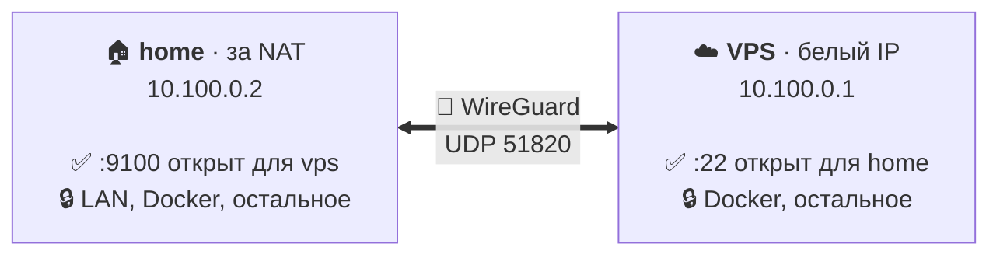

<div align="center">


**Закрытый по умолчанию WireGuard-канал между двумя Linux-серверами: одна команда на шаг и ничего не открыто случайно.**

[](https://github.com/nikitakiselev/meshly/actions/workflows/ci.yml)
[](https://github.com/nikitakiselev/meshly/releases)
[](LICENSE)
[](go.mod)

[English](README.md) · **Русский**

</div>

meshly объединяет два Linux-сервера в одну приватную сеть: они видят друг друга
по адресам `10.100.0.1` и `10.100.0.2`, как будто стоят в одной локальной сети.
Связь зашифрована (WireGuard), а по умолчанию всё закрыто: вы сами решаете, к
каким портам один сервер может подключаться на другом.

Например, у вас есть VPS с белым IP и домашний homelab за роутером, и вы хотите,
чтобы они безопасно общались между собой: SSH, база данных, мониторинг, бэкапы.
meshly соединит их за несколько команд, без конфигов и ручной настройки WireGuard
и firewall. Через канал будет доступно только то, что вы разрешили, например
`meshly allow 22/tcp from home`.



> [!NOTE]
> meshly на ранней стадии (0.0.x). CLI и форматы файлов на диске ещё могут меняться между минорными версиями.
> Прежде чем на него полагаться, прочитайте [модель угроз](docs/threat-model.md) и
> [что пока не проверено](docs/testing.md#not-verified).

## Содержание

- [Возможности](#возможности)
- [Требования](#требования)
- [Установка](#установка)
- [Быстрый старт](#быстрый-старт)
- [Повседневные задачи](#повседневные-задачи)
- [Как это устроено](#как-это-устроено)
- [Безопасность](#безопасность)
- [Документация](#документация)
- [Вопросы и ответы](#вопросы-и-ответы)
- [Участие в разработке](#участие-в-разработке)
- [Лицензия](#лицензия)

## Возможности

- **Запрещено всё, что не разрешено.** Соседу доступны только порты, перечисленные через `meshly allow`. Правило
  действует только для трафика, пришедшего через туннель, и только в одну сторону (сосед → этот узел).
  `meshly deny` обрывает и уже установленные соединения.
- **Никаких случайных утечек.** Нет пересылки пакетов в туннель и из него, нет доступа к локальной сети, нет IPv6
  внутри VPN. Проброс портов Docker (DNAT) не позволяет обойти политику. Пакеты с подменённым адресом отбрасываются.
- **Безопасное подключение без сервера.** Подключение идёт по шагам invite → join → approve → activate. Все четыре
  файла одноразовые, ограничены по времени и подписаны Ed25519. Каждая сторона сверяет отпечаток другой глазами, и
  ни один секрет не передаётся в аргументах командной строки.
- **Безопасные изменения.** Каждое изменение — транзакция с журналом, проверкой и откатом. Если сбой оставил туннель
  в неизвестном состоянии, meshly его закрывает (*safe mode*), а не оставляет открытым. Операция, прерванная сбоем
  или отключением питания, завершается или откатывается при следующем запуске.
- **Уважает ваш firewall.** meshly владеет одной таблицей nftables — `inet meshly`, заменяет её атомарно и не
  трогает ничего другого. Неподдерживаемые конфигурации (ufw, firewalld, правила iptables-legacy, чужие
  запрещающие цепочки без интеграции) обнаруживаются *до* каких-либо изменений.
- **Переживает реальный мир.** NAT и простой (keepalive с обеих сторон), перезапуск VPS (мгновенное повторное
  рукопожатие по запомненным адресам), перезагрузки, `systemctl restart nftables` и `flush ruleset`. Ежеминутная
  проверка целостности исправляет расхождения.
- **Понятная диагностика.** `meshly status` и `meshly doctor` выдают отчёт для человека или стабильный JSON с
  `--json`. Коды выхода стабильны, и у каждого вывода указано, наблюдение это или предположение.
- **Подписанное самообновление.** `meshly upgrade` ставит последний релиз с GitHub после проверки подписи Ed25519 и
  SHA-256. Он перезапускает сервис и откатывается, если новая версия не запустилась. Релизные сборки
  воспроизводимы.

## Требования

| | |
|---|---|
| ОС | Linux с systemd. Проверено на **Debian 12** и **Ubuntu 24.04** |
| Архитектура | `amd64`, `arm64` |
| Ядро | WireGuard в ядре (встроенный или модулем; подойдёт любое ядро дистрибутива 5.6+) |
| Firewall | только nftables ≥ 1.0.6 (`/usr/sbin/nft`) или отсутствие firewall. Не поддерживаются: ufw, firewalld, правила iptables-legacy |
| Сеть | Одному узлу нужен публичный UDP-порт (по умолчанию `51820`), доступный второму узлу |
| Утилиты | `curl` или `wget`, `openssl`, `sha256sum` (только для установщика) |

meshly работает от root (`sudo`). Он не ставит пакеты и не меняет глобальные sysctl. Облачные firewall и группы
безопасности он не настраивает.

## Установка

Выполните на **обоих** серверах:

```sh
curl -fsSL https://github.com/nikitakiselev/meshly/releases/latest/download/install.sh | sudo sh
```

Установщик скачивает бинарник для вашей архитектуры и проверяет подпись Ed25519 файла `SHA256SUMS` ключом релизов,
встроенным в скрипт. Затем он проверяет SHA-256 бинарника и ставит его в `/usr/local/bin/meshly`. Больше он ничего не
меняет: сеть, firewall и systemd настраиваются позже командами `meshly init`, `meshly join` и `meshly activate`.

<details>
<summary>Установить конкретную версию, сначала прочитать установщик или проверить всё вручную</summary>

```sh
# конкретная версия
curl -fsSL https://github.com/nikitakiselev/meshly/releases/latest/download/install.sh | sudo MESHLY_VERSION=0.0.1 sh

# прочитать скрипт перед запуском
curl -fsSLO https://github.com/nikitakiselev/meshly/releases/latest/download/install.sh
less install.sh && sudo sh install.sh
```

Ручная проверка с публичным ключом из [`release-key.pub`](release-key.pub):

```sh
V=0.0.1; A=amd64   # или arm64
base=https://github.com/nikitakiselev/meshly/releases/download/v$V
curl -fsSLO $base/SHA256SUMS -O $base/SHA256SUMS.sig -O $base/meshly-$V-linux-$A
printf '%s\n' '-----BEGIN PUBLIC KEY-----' "MCowBQYDK2VwAyEA$(curl -fsSL https://raw.githubusercontent.com/nikitakiselev/meshly/main/release-key.pub)" '-----END PUBLIC KEY-----' > meshly-release.pem
{ printf 'meshly-release/1\000'; cat SHA256SUMS; } > msg
openssl base64 -d -A -in SHA256SUMS.sig -out sig
openssl pkeyutl -verify -pubin -inkey meshly-release.pem -rawin -in msg -sigfile sig
sha256sum --ignore-missing -c SHA256SUMS
sudo install -m 0755 meshly-$V-linux-$A /usr/local/bin/meshly
```

Кроме того, workflow [Verify release](.github/workflows/release-verify.yml) пересобирает каждый релиз из исходников
тега и проверяет, что опубликованные бинарники с ними совпадают.
</details>

## Быстрый старт

В примере два сервера:

- **vps**: публичный IP `203.0.113.10`. Разрешите входящий **UDP 51820** в облачном firewall.
- **home**: за NAT, может достучаться до VPS (например, по SSH).

meshly передаёт доверие через небольшие файлы. Копируйте их по каналу, которому уже доверяете, например `scp` на хост
с проверенным SSH-ключом. Все копирования ниже выполняются на **home**, потому что он может достучаться до VPS.

**1. На vps:** создайте сеть и приглашение.

```console
admin@vps:~$ sudo meshly init homelab --name vps --endpoint 203.0.113.10:51820
Network "homelab" created.
  this node:    vps  10.100.0.1 on meshly0
  firewall:     profile none; all inbound VPN traffic is denied until `meshly allow`
  fingerprint:  VJW7-OEX7-FGSZ-Y6TN-AID5-LTGJ-YBDE-OJNN

admin@vps:~$ sudo meshly invite --out home.invite
Invite written to home.invite (one-time, expires 2026-10-17T20:30:33Z).
  fingerprint:  VJW7-OEX7-FGSZ-Y6TN-AID5-LTGJ-YBDE-OJNN   <- the joining admin must see exactly this
```

**2. На home:** заберите приглашение, подключитесь и отправьте запрос обратно.

```console
admin@home:~$ scp admin@203.0.113.10:home.invite .
admin@home:~$ sudo meshly join home.invite --name home
Invite from node "vps" for network "homelab":
  inviter fingerprint: VJW7-OEX7-FGSZ-Y6TN-AID5-LTGJ-YBDE-OJNN
Does this fingerprint match the one printed by `meshly invite` on vps? Type 'yes' to continue: yes

Join request written to home.request. Nothing is trusted yet.
  your fingerprint: ECSR-MFJA-MIHL-ML4O-LBKG-YFZP-ETRH-4A7P   <- the admin of vps must see exactly this at approve

admin@home:~$ scp home.request admin@203.0.113.10:
```

**3. На vps:** одобрите новый узел.

```console
admin@vps:~$ sudo meshly approve home.request
Join request from node "home":
  fingerprint:     ECSR-MFJA-MIHL-ML4O-LBKG-YFZP-ETRH-4A7P
Compare the fingerprint with the one printed by `meshly join` on home. Approve this node? Type 'yes' to approve: yes
Node "home" approved; its key is on meshly0 with allowed IP 10.100.0.2/32 only.
Accept written to home.accept.
```

**4. На home:** активируйте.

```console
admin@home:~$ scp admin@203.0.113.10:home.accept .
admin@home:~$ sudo meshly activate home.accept
Membership in network "homelab" is active.
  this node:  home 10.100.0.2
  peer:       vps 10.100.0.1 via 203.0.113.10:51820
```

**5. Разрешите каждой стороне то, что ей нужно.** Правила локальны: правило открывает порт на том узле, где вы его
выполнили.

```sh
admin@vps:~$  sudo meshly allow 22/tcp from home     # home может ходить по SSH на vps (10.100.0.1)
admin@home:~$ sudo meshly allow 9100/tcp from vps    # vps может читать node_exporter на home (10.100.0.2)
admin@home:~$ sudo meshly allow ping from vps
```

**6. Проверьте.**

```sh
sudo meshly status     # конфигурация, интерфейс, рукопожатие, трафик, правила, расхождения
sudo meshly doctor     # все проверки с вердиктом; код 0 = проблем нет
```

Канал поднимается при загрузке через `meshly.service`. Для скриптов и автоматизации есть неинтерактивные варианты:
`meshly join … --expect-fingerprint FP` и `meshly approve … --expect-fingerprint FP`.

## Повседневные задачи

| Задача | Команда |
|---|---|
| Открыть сервис соседу | `sudo meshly allow 5432/tcp from home` |
| Закрыть (обрывает и установленные соединения) | `sudo meshly deny 5432/tcp from home` |
| Список правил | `sudo meshly rules` |
| Состояние и диагностика | `sudo meshly status`, `sudo meshly doctor`, `sudo meshly doctor --probe 22/tcp` |
| Остановить или запустить канал (stop сохраняется после перезагрузки) | `sudo meshly stop`, `sudo meshly start`, `sudo meshly restart` |
| У VPS сменился IP | `sudo meshly set peer-endpoint vps 198.51.100.7:51820` (на home) |
| Путь с меньшим MTU | `sudo meshly set mtu 1380` (на обоих узлах) |
| Кто и что менял | `sudo meshly logs` |
| Обновиться до последнего релиза | `sudo meshly upgrade` (`--check` — только проверить) |
| Удалить соседа | `sudo meshly revoke home` |
| Удалить meshly с узла | `sudo meshly reset` |

Любая команда, которая что-то меняет, поддерживает `--dry-run`. Подробности — в `meshly help <команда>`. Полный
справочник с кодами выхода и JSON-схемами лежит в [docs/cli.md](docs/cli.md).

## Как это устроено

- **WireGuard в ядре** настраивается через netlink. Нет `wg-quick`, нет shell и нет хуков `PostUp`/`PostDown`:
  meshly не выполняет команд, заданных пользователем.
- **Одна таблица nftables**, `inet meshly`, содержит всю политику. Она заменяется атомарно и несёт метку владельца.
  Чужие таблицы только читаются, чтобы найти конфликты. Если ваш собственный набор правил nftables запрещает всё по
  умолчанию, вы добавляете в свою цепочку одно правило интеграции, и `meshly doctor` выводит его готовым
  ([профили firewall](docs/firewall.md)).
- **Транзакции**: каждое изменение — план шагов, который записывается в журнал, применяется, проверяется и только
  потом фиксируется. Ошибка ведёт к откату, а неизвестное состояние — к safe mode (туннель закрыт).
  [Архитектура](docs/architecture.md).
- **systemd**: `meshly.service` (oneshot) поднимает канал при загрузке после системного firewall.
  `meshly-check.timer` заново применяет политику, если её кто-то удалил. Drop-in заново применяет её после старта
  `nftables.service`.

## Безопасность

- Приватные ключи создаются на узле, хранятся с правами `0600` в `/etc/meshly/keys` и никогда не выводятся, не пишутся
  в логи и не попадают в JSON.
- Файлы подключения подписаны Ed25519 и привязаны друг к другу, поэтому их нельзя ни воспроизвести повторно, ни
  использовать дважды. Сверяются глазами отпечатки ([протокол](docs/bootstrap-protocol.md)).
- Релизы подписываются офлайн-ключом Ed25519. Подпись проверяют и `install.sh`, и `meshly upgrade`.
- Гарантии и то, что вне рамок проекта, описаны в [модели угроз](docs/threat-model.md).

**Об уязвимостях сообщайте приватно:** см. [SECURITY.md](SECURITY.md). Не создавайте для них публичные issue.

## Документация

Документация пока только на английском.

| Документ | Содержание |
|---|---|
| [docs/cli.md](docs/cli.md) | Все команды, флаги, коды выхода и JSON-вывод |
| [docs/architecture.md](docs/architecture.md) | Компоненты, состояние на диске, транзакции, systemd, обновление; проектные решения |
| [docs/bootstrap-protocol.md](docs/bootstrap-protocol.md) | Спецификация invite / join / approve / activate |
| [docs/firewall.md](docs/firewall.md) | Путь пакета, таблица `inet meshly`, поддерживаемые профили firewall, Docker |
| [docs/threat-model.md](docs/threat-model.md) | Активы, нарушители, гарантии и что вне рамок |
| [docs/diagnostics-and-recovery.md](docs/diagnostics-and-recovery.md) | Как читать `status` и `doctor`; инструкции; восстановление и safe mode |
| [docs/testing.md](docs/testing.md) | Модульные, fuzz- и интеграционные тесты; что проверено и что нет |
| [docs/roadmap.md](docs/roadmap.md) | Планы |
| [CHANGELOG.md](CHANGELOG.md) | История релизов |

## Вопросы и ответы

**Чем это лучше `wg-quick`?** `wg-quick` поднимает туннель. Он не решает, что через этот туннель можно, не мешает
Docker или пересылке пакетов открыть вашу локальную сеть и не откатывает наполовину применённое изменение. meshly
делает всё это.

**Можно ли соединить больше двух серверов?** Пока нет. В 0.0.x в сети ровно два узла. См. [roadmap](docs/roadmap.md).

**Работает ли с ufw или firewalld?** Нет. meshly их обнаруживает и отказывается что-либо менять, потому что рядом с
ними не может гарантировать свою политику. Поддерживается собственный nftables или отсутствие firewall.

**Доступны ли мои Docker-контейнеры через VPN?** Нет. Опубликованные порты работают через DNAT, а meshly отбрасывает
DNAT и пересылку для трафика из туннеля. Чтобы открыть сервис контейнера, опубликуйте его на хосте и разрешите этот
порт. Подробности — в [документации по firewall](docs/firewall.md#docker).

**Что будет, если VPS перезагрузится?** Домашний узел заново выполнит рукопожатие, как только VPS вернётся. Обе
стороны шлют keepalive, а meshly помнит последний подтверждённый адрес соседа.

**Как удалить?** Выполните `sudo meshly reset` (удаляет интерфейс, таблицу firewall, конфигурацию, ключи и юниты),
затем `sudo rm /usr/local/bin/meshly`.

## Участие в разработке

Сообщения об ошибках, идеи и pull request приветствуются. В [CONTRIBUTING.md](CONTRIBUTING.md) описано, как
настроить окружение (модульные, fuzz- и интеграционные тесты запускаются локально в Docker), а правила общения — в
[Code of Conduct](CODE_OF_CONDUCT.md).

## Лицензия

[Apache License 2.0](LICENSE).
