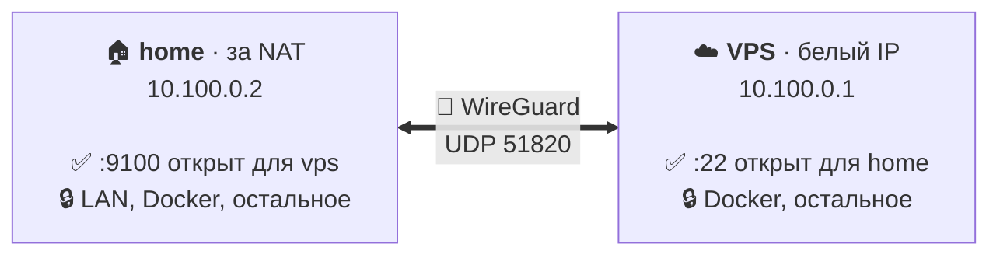

<div align="center">


**Закрытый по умолчанию WireGuard-канал между двумя Linux-серверами: одна команда на шаг и ничего не открыто случайно.**

[](https://github.com/nikitakiselev/meshly/actions/workflows/ci.yml)
[](https://github.com/nikitakiselev/meshly/releases)
[](LICENSE)
[](go.mod)

[English](README.md) · **Русский**

</div>

meshly объединяет два Linux-сервера в одну приватную сеть: они видят друг друга
по адресам `10.100.0.1` и `10.100.0.2`, как будто стоят в одной локальной сети.
Связь зашифрована (WireGuard), а по умолчанию всё закрыто: вы сами решаете, к
каким портам один сервер может подключаться на другом.

Например, у вас есть VPS с белым IP и домашний homelab за роутером, и вы хотите,
чтобы они безопасно общались между собой: SSH, база данных, мониторинг, бэкапы.
meshly соединит их за несколько команд, без конфигов и ручной настройки WireGuard
и firewall. Через канал будет доступно только то, что вы разрешили, например
`meshly allow 22/tcp from home`.



> [!NOTE]
> meshly на ранней стадии (0.0.x). CLI и форматы файлов на диске ещё могут меняться между минорными версиями.
> Прежде чем на него полагаться, прочитайте [модель угроз](docs/threat-model.md) и
> [что пока не проверено](docs/testing.md#not-verified).

## Содержание

- [Возможности](#возможности)
- [Требования](#требования)
- [Установка](#установка)
- [Быстрый старт](#быстрый-старт)
- [Повседневные задачи](#повседневные-задачи)
- [Как это устроено](#как-это-устроено)
- [Безопасность](#безопасность)
- [Документация](#документация)
- [Вопросы и ответы](#вопросы-и-ответы)
- [Участие в разработке](#участие-в-разработке)
- [Лицензия](#лицензия)

## Возможности

- **Запрещено всё, что не разрешено.** Соседу доступны только порты, перечисленные через `meshly allow`. Правило
  действует только для трафика, пришедшего через туннель, и только в одну сторону (сосед → этот узел).
  `meshly deny` обрывает и уже установленные соединения.
- **Никаких случайных утечек.** Нет пересылки пакетов в туннель и из него, нет доступа к локальной сети, нет IPv6
  внутри VPN. Проброс портов Docker (DNAT) не позволяет обойти политику. Пакеты с подменённым адресом отбрасываются.
- **Безопасное подключение без сервера.** `meshly invite` печатает одноразовый код, а `meshly join` на втором
  сервере просит его ввести. Серверы обмениваются ключами через уже открытый порт WireGuard, поэтому ничего нового не
  становится доступно ни из интернета, ни другим пользователям сервера, даже пока приглашение ждёт. Код срабатывает
  один раз, живёт 10 минут и никогда не передаётся в аргументах командной строки.
- **Безопасные изменения.** Каждое изменение — транзакция с журналом, проверкой и откатом. Если сбой оставил туннель
  в неизвестном состоянии, meshly его закрывает (*safe mode*), а не оставляет открытым. Операция, прерванная сбоем
  или отключением питания, завершается или откатывается при следующем запуске.
- **Работает с вашим firewall.** meshly владеет одной таблицей nftables — `inet meshly` — и заменяет её атомарно.
  Если на сервере UFW или правила iptables, meshly держит одно правило в начале их цепочек `INPUT` и `OUTPUT`,
  которое пропускает только то, что разрешил сам meshly; `ufw allow` не нужен. fail2ban тоже ничего не требует.
  Больше meshly ничего не трогает.
  Неподдерживаемые конфигурации (firewalld, правила iptables-legacy, собственные запрещающие цепочки nftables без
  правила интеграции) обнаруживаются *до* каких-либо изменений.
- **Переживает реальный мир.** NAT и простой (keepalive с обеих сторон), перезапуск VPS (мгновенное повторное
  рукопожатие по запомненным адресам), перезагрузки, `systemctl restart nftables` и `flush ruleset`. Ежеминутная
  проверка целостности исправляет расхождения.
- **Понятная диагностика.** `meshly status` и `meshly doctor` выдают отчёт для человека или стабильный JSON с
  `--json`. Коды выхода стабильны, и у каждого вывода указано, наблюдение это или предположение.
- **Подписанное самообновление.** `meshly upgrade` ставит последний релиз с GitHub после проверки подписи Ed25519 и
  SHA-256. Он перезапускает сервис и откатывается, если новая версия не запустилась. Релизные сборки
  воспроизводимы.

## Требования

| | |
|---|---|
| ОС | Linux с systemd. Проверено на **Debian 12** и **Ubuntu 24.04** |
| Архитектура | `amd64`, `arm64` |
| Ядро | WireGuard в ядре (встроенный или модулем; подойдёт любое ядро дистрибутива 5.6+) |
| Firewall | нужен nftables ≥ 1.0.6 (`/usr/sbin/nft`). Firewall сервера: никакого, UFW, правила iptables (`iptables-nft`, бэкенд по умолчанию) или собственный набор правил nftables, с fail2ban или без. Не поддерживаются: firewalld, правила iptables-legacy |
| Сеть | Одному узлу нужен публичный UDP-порт (по умолчанию `51820`), доступный второму узлу |
| Утилиты | `curl` или `wget`, `openssl`, `sha256sum` (только для установщика) |

meshly работает от root (`sudo`). Он не ставит пакеты и не меняет глобальные sysctl. Облачные firewall и группы
безопасности он не настраивает.

## Установка

Выполните на **обоих** серверах:

```sh
curl -fsSL https://github.com/nikitakiselev/meshly/releases/latest/download/install.sh | sudo sh
```

Установщик скачивает бинарник для вашей архитектуры и проверяет подпись Ed25519 файла `SHA256SUMS` ключом релизов,
встроенным в скрипт. Затем он проверяет SHA-256 бинарника и ставит его в `/usr/local/bin/meshly`. Больше он ничего не
меняет: сеть, firewall и systemd настраиваются позже командами `meshly init` и `meshly join`.

<details>
<summary>Установить конкретную версию, сначала прочитать установщик или проверить всё вручную</summary>

```sh
# конкретная версия
curl -fsSL https://github.com/nikitakiselev/meshly/releases/latest/download/install.sh | sudo MESHLY_VERSION=0.0.1 sh

# прочитать скрипт перед запуском
curl -fsSLO https://github.com/nikitakiselev/meshly/releases/latest/download/install.sh
less install.sh && sudo sh install.sh
```

Ручная проверка с публичным ключом из [`release-key.pub`](release-key.pub):

```sh
V=0.0.1; A=amd64   # или arm64
base=https://github.com/nikitakiselev/meshly/releases/download/v$V
curl -fsSLO $base/SHA256SUMS -O $base/SHA256SUMS.sig -O $base/meshly-$V-linux-$A
printf '%s\n' '-----BEGIN PUBLIC KEY-----' "MCowBQYDK2VwAyEA$(curl -fsSL https://raw.githubusercontent.com/nikitakiselev/meshly/main/release-key.pub)" '-----END PUBLIC KEY-----' > meshly-release.pem
{ printf 'meshly-release/1\000'; cat SHA256SUMS; } > msg
openssl base64 -d -A -in SHA256SUMS.sig -out sig
openssl pkeyutl -verify -pubin -inkey meshly-release.pem -rawin -in msg -sigfile sig
sha256sum --ignore-missing -c SHA256SUMS
sudo install -m 0755 meshly-$V-linux-$A /usr/local/bin/meshly
```

Кроме того, workflow [Verify release](.github/workflows/release-verify.yml) пересобирает каждый релиз из исходников
тега и проверяет, что опубликованные бинарники с ними совпадают.
</details>

## Быстрый старт

В примере два сервера:

- **vps**: публичный IP `203.0.113.10`. Разрешите входящий **UDP 51820** в облачном firewall.
- **home**: за NAT, достаёт до VPS по этому UDP-порту.

`meshly invite` на vps печатает код, а вы вставляете его в `meshly join` на home. Копируйте код из своего
терминала: он срабатывает один раз и живёт 10 минут. В примерах ниже опущены шаги, которые каждая команда
перечисляет, пока их применяет.

**1. На vps:** создайте сеть.

```console
admin@vps:~$ sudo meshly init homelab --name vps
Network "homelab" created.
  this node:    vps  10.100.0.1 on meshly0
  endpoint:     203.0.113.10:51820, detected on eth0 (to change: meshly set endpoint IP)
                UDP 51820 must be reachable; cloud firewalls are not managed by meshly
  firewall:     profile none; all inbound VPN traffic is denied until `meshly allow`
  public key:   bWcWhZaUNdCDGVVlpXq8o/ep9g9jtumd2jC7Zsju9C4=

Next: run `sudo meshly invite` on this node and `sudo meshly join` on the other.
```

Искать адрес VPS не нужно: meshly сам находит публичный IP на его сетевом интерфейсе и берёт стандартный порт WireGuard
51820. Некоторые облака (AWS, GCP) дают серверу только приватный адрес, а публичный подставляют снаружи. Тогда meshly
сообщит, что адрес не найден, и его нужно указать самому: `--endpoint 203.0.113.10`.

**2. На vps:** откройте приглашение. Команда печатает код и ждёт.

```console
admin@vps:~$ sudo meshly invite
Waiting for a node to join network "homelab" until 20:40 UTC (10 minutes). Ctrl+C cancels.
On the other node run `sudo meshly join` and paste this code:

m1atfqa4ikzjwg2zywqwljinoqqmmvkznfpk6kh55j6yhwhnxjtxndbo3gzdxpilqkmqaaagdk2uxkasjvuxzmxu2ljlylk2tq5xtgw2omnywbs

Node "home" (10.100.0.2) joined. The invite is closed.
```

Последняя строка появится, когда home подключится на шаге 3. После этого приглашение закроется само, и код перестанет
работать. Пока оно ждёт, из интернета не видно ничего нового: серверы общаются через порт WireGuard.

**3. На home:** подключитесь и вставьте код, когда команда его попросит.

```console
admin@home:~$ sudo meshly join
Invite code: m1atfqa4ikzjwg2zywqwljinoqqmmvkznfpk6kh55j6yhwhnxjtxndbo3gzdxpilqkmqaaagdk2uxkasjvuxzmxu2ljlylk2tq5xtgw2omnywbs
Connecting to 203.0.113.10:51820...
Joined network "homelab" as "home" (10.100.0.2).
  peer:  vps 10.100.0.1 via 203.0.113.10:51820
Inbound VPN traffic to this node is denied until you run `meshly allow` here.
```

Узел получает имя по имени хоста (здесь `home`); другое имя задаётся через `--name`. Если home не достаёт до VPS по
UDP 51820, `join` сообщит об этом через 30 секунд и ничего не изменит.

**4. Разрешите каждой стороне то, что ей нужно.** Правила локальны: правило открывает порт на том узле, где вы его
выполнили.

```sh
admin@vps:~$  sudo meshly allow 22/tcp from home     # home может ходить по SSH на vps (10.100.0.1)
admin@home:~$ sudo meshly allow 9100/tcp from vps    # vps может читать node_exporter на home (10.100.0.2)
admin@home:~$ sudo meshly allow ping from vps
```

**5. Проверьте.**

```sh
sudo meshly nodes      # узлы сети и есть ли с ними связь
sudo meshly ping home  # на vps: ping через туннель; если home не отвечает, объясняет почему
sudo meshly status     # конфигурация, интерфейс, рукопожатие, трафик, правила, расхождения
sudo meshly doctor     # все проверки с вердиктом; код 0 = проблем нет
```

Канал поднимается при загрузке через `meshly.service`. Для скриптов `meshly join` читает код и из stdin: см.
[подключение из скрипта](docs/cli.md#pairing-from-a-script).

## Повседневные задачи

| Задача | Команда |
|---|---|
| Открыть сервис соседу | `sudo meshly allow 5432/tcp from home` |
| Закрыть (обрывает и установленные соединения) | `sudo meshly deny 5432/tcp from home` |
| Список правил | `sudo meshly rules` |
| Кто в сети, работает ли связь | `sudo meshly nodes`, `sudo meshly ping home` |
| Состояние и диагностика | `sudo meshly status`, `sudo meshly doctor`, `sudo meshly doctor --probe 22/tcp` |
| Остановить или запустить канал (stop сохраняется после перезагрузки) | `sudo meshly stop`, `sudo meshly start`, `sudo meshly restart` |
| У VPS сменился IP | `sudo meshly set peer-endpoint vps 198.51.100.7` (на home) |
| Путь с меньшим MTU | `sudo meshly set mtu 1380` (на обоих узлах) |
| Кто и что менял | `sudo meshly logs` |
| Обновиться до последнего релиза | `sudo meshly upgrade` (`--check` — только проверить) |
| Удалить соседа | `sudo meshly revoke home` |
| Удалить meshly с узла | `sudo meshly reset` |

`init`, `allow`, `deny`, `revoke`, `start`, `stop` и `set` поддерживают `--dry-run`. Подробности — в
`meshly help <команда>`. Полный справочник с кодами выхода и JSON-схемами лежит в [docs/cli.md](docs/cli.md).

## Как это устроено

- **WireGuard в ядре** настраивается через netlink. Нет `wg-quick`, нет shell и нет хуков `PostUp`/`PostDown`:
  meshly не выполняет команд, заданных пользователем.
- **Одна таблица nftables**, `inet meshly`, содержит всю политику. Она заменяется атомарно и несёт метку владельца.
  Чужие таблицы только читаются, чтобы найти конфликты. Если ваш собственный набор правил nftables запрещает всё по
  умолчанию, вы добавляете в свою цепочку одно правило интеграции, и `meshly doctor` выводит его готовым
  ([профили firewall](docs/firewall.md)).
- **Транзакции**: каждое изменение — план шагов, который записывается в журнал, применяется, проверяется и только
  потом фиксируется. Ошибка ведёт к откату, а неизвестное состояние — к safe mode (туннель закрыт).
  [Архитектура](docs/architecture.md).
- **systemd**: `meshly.service` (oneshot) поднимает канал при загрузке после системного firewall.
  `meshly-check.timer` заново применяет политику, если её кто-то удалил. Drop-in заново применяет её после старта
  `nftables.service`.

## Безопасность

- Приватные ключи создаются на узле, хранятся с правами `0600` в `/etc/meshly/keys` и никогда не выводятся, не пишутся
  в логи и не попадают в JSON.
- Код приглашения — одноразовый секрет. В нём записан публичный ключ WireGuard этого VPS, так что home общается
  только с ним. Ещё в нём случайный секрет: пока приглашение ждёт, войти может только тот, у кого есть код. Код
  никогда не принимается в аргументах и не пишется в логи ([протокол подключения](docs/pairing-protocol.md)).
  Копируйте его сами, из своего терминала: подключиться может любой, у кого он есть.
- Релизы подписываются офлайн-ключом Ed25519. Подпись проверяют и `install.sh`, и `meshly upgrade`.
- Гарантии и то, что вне рамок проекта, описаны в [модели угроз](docs/threat-model.md).

**Об уязвимостях сообщайте приватно:** см. [SECURITY.md](SECURITY.md). Не создавайте для них публичные issue.

## Документация

Документация пока только на английском.

| Документ | Содержание |
|---|---|
| [docs/cli.md](docs/cli.md) | Все команды, флаги, коды выхода и JSON-вывод |
| [docs/architecture.md](docs/architecture.md) | Компоненты, состояние на диске, транзакции, systemd, обновление; проектные решения |
| [docs/pairing-protocol.md](docs/pairing-protocol.md) | Код приглашения и то, как `invite` и `join` соединяют два узла |
| [docs/firewall.md](docs/firewall.md) | Путь пакета, таблица `inet meshly`, поддерживаемые профили firewall, Docker |
| [docs/threat-model.md](docs/threat-model.md) | Активы, нарушители, гарантии и что вне рамок |
| [docs/diagnostics-and-recovery.md](docs/diagnostics-and-recovery.md) | Как читать `status` и `doctor`; инструкции; восстановление и safe mode |
| [docs/testing.md](docs/testing.md) | Модульные, fuzz- и интеграционные тесты; что проверено и что нет |
| [docs/roadmap.md](docs/roadmap.md) | Планы |
| [CHANGELOG.md](CHANGELOG.md) | История релизов |

## Вопросы и ответы

**Чем это лучше `wg-quick`?** `wg-quick` поднимает туннель. Он не решает, что через этот туннель можно, не мешает
Docker или пересылке пакетов открыть вашу локальную сеть и не откатывает наполовину применённое изменение. meshly
делает всё это.

**`meshly join` пишет, что VPS не ответил.** Либо приглашение уже закрыто (истекло, отменено или использовано), либо
UDP 51820 не доходит до VPS: проверьте его облачный firewall. На home при этом ничего не изменилось. Если приглашение
закрылось, снова запустите `sudo meshly invite` на VPS, затем `sudo meshly join` на home.

**Можно ли соединить больше двух серверов?** Пока нет. В 0.0.x в сети ровно два узла. См. [roadmap](docs/roadmap.md).

**Работает ли с UFW, iptables или fail2ban?** Да, и настраивать ничего не нужно. meshly держит одно правило в начале цепочек
`INPUT` и `OUTPUT`, которое пропускает только то, что разрешила политика самого meshly, включая порт WireGuard, и
возвращает его, если перезагрузка правил его удалила. Весь остальной трафик по-прежнему решает UFW. Баны fail2ban
продолжают действовать; если бан задел второй узел, meshly предупредит и подскажет, как его снять. firewalld и бэкенд
iptables-legacy не поддерживаются: meshly их обнаруживает и ничего не меняет. Подробнее в
[документации по firewall](docs/firewall.md#iptables-and-ufw).

**Доступны ли мои Docker-контейнеры через VPN?** Нет. Опубликованные порты работают через DNAT, а meshly отбрасывает
DNAT и пересылку для трафика из туннеля. Чтобы открыть сервис контейнера, опубликуйте его на хосте и разрешите этот
порт. Подробности — в [документации по firewall](docs/firewall.md#docker).

**Что будет, если VPS перезагрузится?** Домашний узел заново выполнит рукопожатие, как только VPS вернётся. Обе
стороны шлют keepalive, а meshly помнит последний подтверждённый адрес соседа.

**Как удалить?** Выполните `sudo meshly reset` (удаляет интерфейс, таблицу firewall, конфигурацию, ключи и юниты),
затем `sudo rm /usr/local/bin/meshly`.

## Участие в разработке

Сообщения об ошибках, идеи и pull request приветствуются. В [CONTRIBUTING.md](CONTRIBUTING.md) описано, как
настроить окружение (модульные, fuzz- и интеграционные тесты запускаются локально в Docker), а правила общения — в
[Code of Conduct](CODE_OF_CONDUCT.md).

## Лицензия

[Apache License 2.0](LICENSE).
