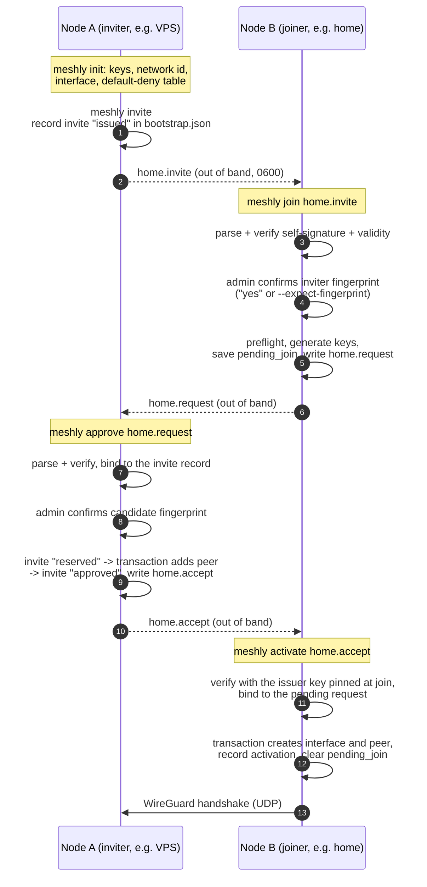

# Bootstrap protocol (`meshly-bootstrap/1`)

This document specifies how two nodes establish mutual trust: **invite →
join request → approve (join accept) → activate**. The protocol has no
network component. The administrators move three small signed files over a
channel they already trust, for example `scp` with a verified host key.
Trust comes from comparing two short fingerprints, one per direction.
The signatures make sure that what was compared is exactly what gets
installed. The implementation is in `internal/bootstrap` (format and
validation), `internal/store/bootstrap.go` (persistent state) and
`internal/cli/cmd_bootstrap.go` (binding rules and commands).

See also: [architecture](architecture.md), [threat model](threat-model.md),
[CLI reference and exit codes](cli.md), [testing](testing.md).

## Overview



No step grants anything on its own:

- `join` creates no interface and no peer. The joiner's kernel stays unchanged.
- `approve` puts the candidate's WireGuard key on A, with allowed IPs set to
  its `/32` only. Default deny still applies, so no service is reachable for
  it until `meshly allow`.
- `activate` connects B. Inbound traffic to B is denied until B's admin runs
  `meshly allow` there.

## Cryptographic primitives

meshly implements no cryptographic algorithm itself. It uses:

| Purpose | Primitive | Implementation |
|---|---|---|
| Node identity, message signatures | Ed25519 | Go standard library `crypto/ed25519` |
| Message digests, fingerprints | SHA-256 | Go standard library `crypto/sha256` |
| Identity key generation, invite/request IDs | CSPRNG | Go standard library `crypto/rand` |
| WireGuard key pair | Curve25519 | `golang.zx2c4.com/wireguard/wgctrl/wgtypes.GeneratePrivateKey` |
| Tunnel encryption | WireGuard (Noise IK) | Linux kernel WireGuard module |
| Encodings | base64, base64url, base32, hex | Go standard library `encoding/*` |

Each node has two key pairs, generated at `init` (inviter) or `join` (joiner):

- an Ed25519 **identity key**, used only to sign bootstrap messages;
- a WireGuard **Curve25519 key**, used by the kernel tunnel.

Private keys live in `/etc/meshly/keys/identity.key` (the 32-byte Ed25519
seed) and `/etc/meshly/keys/wireguard.key`, both base64, mode `0600`, in a
`0700` directory. They never appear in bootstrap files, output, logs or
`--json`. No WireGuard preshared key is used.

## Envelope

Every file is a JSON envelope. `meshly` writes it indented with two spaces
and ends it with a newline:

```json
{
  "format": "meshly-bootstrap",
  "version": 1,
  "type": "invite",
  "payload": "<base64url, no padding, of the exact payload bytes>",
  "signature": "<standard base64 of a 64-byte Ed25519 signature>"
}
```

- `type` is one of `invite`, `join-request` or `join-accept`.
- The payload is the compact JSON produced by `encoding/json`. It is limited
  to 32 KiB when sealed. The whole file is limited to 64 KiB
  (`MaxFileSize`) when read.
- **What is signed.** The signature covers the exact payload bytes, with the
  protocol name and the message type in front of them:

  ```
  "meshly-bootstrap/1" || 0x00 || type || 0x00 || payload
  ```

  Signing exact bytes instead of a re-serialised object gives one
  unambiguous signed representation without a canonicalisation scheme. The
  type prefix gives domain separation: a valid invite signature does not
  verify as a join accept made of the same bytes (`TestSignatureDomainSeparation`).
  Release signatures use a different prefix, `meshly-release/1`.
- **Digest.** A message is identified by
  `"sha256:" || hex(SHA-256(signed message))`, computed over the same bytes
  as the signature. Digests bind the messages to each other.

### Strict parsing

The envelope and the payload are parsed by the same strict decoder
(`strictUnmarshal`). It accepts exactly one JSON object and rejects:

- a top-level value that is not an object;
- trailing data after the object;
- a duplicate key at any nesting level;
- any key outside `[a-z0-9_]{1,64}`. `encoding/json` matches field names
  case-insensitively, so without this rule `"INVITE_ID"` would silently alias
  `"invite_id"`;
- nesting deeper than 8 levels;
- unknown fields;
- base64 or base64url that is not strictly canonical (for example, a
  padded payload). The signature must decode to exactly 64 bytes.

As a result, two parsers can never disagree about what a signed file says.
`FuzzOpen` fuzzes this code.

### Versioning

- Envelope `version` and payload `schema_version` must both be `1`. For a
  higher value, the error asks to upgrade this node. Lower or unknown values
  are rejected.
- The payload `type` must equal the envelope `type`.
- The payload `protocol` must be `meshly-bootstrap/1`.

## Messages

Common field types:

- **IDs** (`network.id`, `invite_id`, `request_id`): 128 random bits as 32
  lowercase hex characters.
- **Names**: `^[a-z]([a-z0-9-]{0,30}[a-z0-9])?$`. Reserved names are excluded.
- **Keys**: standard base64 of 32 bytes. An all-zero key is not allowed.
- **Addresses**: IPv4 hosts inside the network CIDR, never its network or
  broadcast address.
- **CIDR**: IPv4, canonical, `/16`–`/30`, inside `10.0.0.0/8`,
  `172.16.0.0/12`, `192.168.0.0/16` or `100.64.0.0/10`.
- **MTU**: 1280–8920.
- **Endpoints**: optional. A unicast `IP:port`; unspecified, multicast,
  broadcast, link-local and IPv6-zoned addresses are rejected.

`NodeInfo` (used for `issuer`, `candidate` and `member`):

| Field | Meaning |
|---|---|
| `name` | node name |
| `identity_key` | Ed25519 public key |
| `wg_public_key` | WireGuard public key |
| `address` | VPN address of the node |
| `endpoint` | public UDP endpoint; omitted when the node has none |

### Invite (`type: invite`)

Created by `meshly invite` on the inviter. Signed by the issuer's identity
key.

| Field | Meaning |
|---|---|
| `schema_version`, `type`, `protocol` | header (`1`, `invite`, `meshly-bootstrap/1`) |
| `network` | `id`, `name`, `cidr`, `mtu` |
| `invite_id` | random ID of this invite |
| `created_at`, `expires_at` | validity; default 1 h, `--ttl` from 1 m to 24 h |
| `issuer` | `NodeInfo` of the inviter |
| `assigned_address` | VPN address reserved for the joiner (the second host of the CIDR) |

Additional checks:

- `assigned_address` is a valid host address and differs from
  `issuer.address`.
- The invite contains no secret. It is still an authorisation token until
  it expires, because anyone holding it can submit a join request. For this
  reason `meshly invite` writes it with mode `0600` and asks for a trusted
  channel.

### Join request (`type: join-request`)

Created by `meshly join` on the joiner. Signed by the candidate's own,
newly generated identity key.

| Field | Meaning |
|---|---|
| header | `1`, `join-request`, `meshly-bootstrap/1` |
| `network_id` | `network.id` from the invite |
| `invite_id`, `invite_digest` | the invite this request answers (digest of the exact invite bytes) |
| `request_id` | random ID of this request |
| `created_at`, `expires_at` | `expires_at` equals the invite's `expires_at` |
| `candidate` | `NodeInfo` of the joiner; `address` = `assigned_address` from the invite |

### Join accept (`type: join-accept`)

Created by `meshly approve` on the inviter after explicit approval. Signed
by the issuer's identity key.

| Field | Meaning |
|---|---|
| header | `1`, `join-accept`, `meshly-bootstrap/1` |
| `network` | as in the invite |
| `invite_id`, `invite_digest` | the invite |
| `request_id`, `request_digest` | the exact request that was approved |
| `created_at`, `expires_at` | the approval time + 24 h (`AcceptTTL`) |
| `issuer` | `NodeInfo` of the inviter |
| `member` | `NodeInfo` of the approved joiner: its keys, its address and the endpoint it requested |

## Fingerprints

```
fingerprint = base32( SHA-256("meshly-fingerprint/1" || 0x00 || identity_pub || wg_pub)[0:20] )
```

- The fingerprint is 160 bits, encoded as 32 characters of the RFC 4648
  base32 alphabet without padding. It is shown in 8 groups of 4, for
  example `VJW7-OEX7-FGSZ-Y6TN-AID5-LTGJ-YBDE-OJNN`.
- It covers **both** public keys. Replacing only the WireGuard key changes
  the fingerprint (`TestFingerprint`).
- Comparison ignores case and the separators `-`, space and `:`. Exactly
  32 characters must remain.
- Where it is shown:
  - `init`, `invite` and `status` show a node's own fingerprint;
  - `join` shows the inviter's fingerprint and then the joiner's own;
  - `approve` shows the candidate's fingerprint, identity key and WireGuard key.

The self-signatures on invites and requests only prove integrity relative to
the key embedded in the file. **Authenticity comes from the administrator
comparing the fingerprint** with the one printed on the other node.
Therefore both `join` and `approve` refuse to continue without a
confirmation:

- **interactive** (stdin and stderr are terminals): the admin types `yes`
  after comparing;
- **non-interactive**: `--expect-fingerprint <FP>` is mandatory, and a
  mismatch aborts.

Both paths exit with code 10 (`ExitDeclined`) on refusal, a mismatch or a
missing confirmation. `approve --dry-run` skips the confirmation and changes
nothing.

## Validity, clocks and expiry

`checkValidity` applies the same rules to every message:

- `created_at` and `expires_at` are both present, and `expires_at` is later
  than `created_at`.
- `expires_at - created_at` does not exceed the maximum for the type: 24 h
  for invites and requests, 24 h for accepts. A longer signed period is
  rejected (`TestValidityPeriod`).
- `created_at` is not later than `now + 5 min` (`ClockSkew`). A message
  "created in the future" asks to check both clocks.
- `now < expires_at`. There is no grace period after expiry. The error
  suggests creating a new invite.

In the full flow:

- `approve` must happen before the invite expires. The request carries the
  invite's expiry, and the inviter also checks its own record of the invite.
- `activate` must happen within 24 h of approval.
- When `activate` re-reads the stored copy of the invite, it uses the time
  of the `join`, because the invite was verified then and may have expired
  since.

## State and binding

### Inviter: `/var/lib/meshly/bootstrap.json` (mode 0600)

Each invite has a record: ID, digest, validity, assigned address, the
envelope, a status and, once used, the bound request ID and digest, the
candidate name and fingerprint, the signed accept and the decision time.

| Status | Meaning |
|---|---|
| `issued` | created, no request bound yet |
| `reserved` | bound to exactly one request digest; approval decided, kernel change not yet complete |
| `approved` | the bound request was approved and applied |
| `cancelled` | superseded by `meshly invite --new` |

Records are kept after use, so a used `invite_id` can never be bound again.
The newest 200 records are kept. `meshly reset` deletes the whole file
together with the keys and the configuration. Messages of the old network
then stop working, because a new `init` creates a new network ID and new
keys.

`approve` binds a request to an invite as follows (`checkRequestBinding`):

1. `network_id` equals this node's network.
2. `invite_id` refers to an invite this node issued.
3. `invite_digest` equals the digest of the invite as issued, so a request
   made for a modified copy is refused.
4. The invite is not `cancelled`.
5. If the invite is already `reserved` or `approved`, the request digest must
   equal the bound one. Otherwise: *"invites are one-time"*. If the
   bound request was approved and its peer has since been revoked, the
   request is refused: a new invite is required.
6. An `issued` invite must not have expired according to the inviter's
   own record.
7. The candidate address equals the assigned address.
8. The candidate does not use this node's name or keys.
9. The network has no other peer. This version supports exactly two nodes.
10. At least one of the two nodes has a public endpoint.

The order of effects is:

1. sign the accept;
2. persist the record as `reserved`, bound to this request (before any
   kernel change);
3. run the `approve` transaction, which adds the peer with
   `allowed-ips <address>/32` and records `TrustDigest = request digest`;
4. persist the record as `approved`;
5. write the accept file.

### Joiner: `pending_join` and `activations`

- `join` saves `pending_join`. Nothing reaches the kernel at this step. It
  contains:
  - the invite and request envelopes and their digests;
  - the chosen settings: name, listen port, keepalive, endpoint,
    interface, firewall profile;
  - **the issuer identity key, pinned from the verified invite.**
- `activate` verifies the accept signature with the **pinned** key before
  decoding the payload. It then requires `issuer.identity_key` to equal that
  key and checks the binding (`checkAcceptBinding`):
  - `request_id`/`request_digest` equal the pending request;
  - `invite_id`/`invite_digest` equal the pending invite;
  - `network` equals the invite's network exactly;
  - `issuer` equals the invite's issuer exactly (keys, address, endpoint).
    Changing keys requires a new trust procedure;
  - `member` keys equal this node's own keys; `member` name equals the
    requested name; `member` address equals the assigned address; `member`
    endpoint equals the requested endpoint.
- After a successful `activate` transaction, the accept digest is appended
  to `activations` and `pending_join` is cleared. The configured peer records
  `TrustDigest = accept digest`.

## Replay and one-time use

| Replay | Result |
|---|---|
| A second request (other keys) for a used invite | rejected, exit 4, "one-time" |
| The approved request again, after the peer was revoked | rejected, exit 4, "revoked" |
| The same request again before expiry | idempotent: no new confirmation, same accept |
| A request for an invite superseded by `invite --new` | rejected, exit 4, "cancelled" |
| An accept on a node without a pending join | rejected, exit 5 |
| An accept on another node that has its own pending join | rejected, exit 4 (binds to another request) |
| The activated accept again on the same node | idempotent: "already activated", exit 0 |
| Any other accept on a node that is already a member | rejected, exit 5 |
| `join` with a second invite while one join is pending | rejected, exit 5 |

## Idempotent re-runs

Each command can be repeated safely after an interruption or a lost file:

- **`invite`**: if an unexpired invite in state `issued` or `reserved`
  exists, its stored envelope is written again. `--new` cancels it and
  creates a new invite.
- **`join`** with the same invite: the stored request is written again. No
  new keys are generated. Existing key files are reused if a previous
  attempt generated them.
- **`approve`** with the already bound request: the fingerprint confirmation
  is skipped and the transaction is re-applied (a no-op if complete). The
  same accept bytes are written again. This works only while the request is
  valid: the request is parsed, and its expiry checked, before the
  idempotent path is taken. After the invite's expiry, a lost accept file
  cannot be regenerated: revoke the peer and start again with a new invite.
- **`activate`** with the activated accept: reports success without changes.

Repeated `invite`, `join`, `approve` and `activate` are covered by the
integration test `TestIdempotency`.

## Reading and writing the files

**Input** files are read with `store.ReadUntrusted`:

- the path is opened with `O_NOFOLLOW | O_NONBLOCK`, so symlinks are refused;
- only regular files are accepted. FIFOs, devices and directories are
  refused without blocking;
- the size is limited to 64 KiB;
- the content is never echoed in error messages;
- `-` reads from standard input. Stdin is then not a terminal, so
  `--expect-fingerprint` is required.

Each of these failures exits with 4.

**Output** files are written with `store.WriteOutput`:

- the file is created with `O_CREAT | O_EXCL | O_NOFOLLOW`;
- modes: the invite is `0600`; the request and the accept are `0644` (they
  contain no secrets);
- an existing file with **identical** content is left as is, which makes
  re-runs idempotent;
- an existing file with different content is refused (exit 5) unless
  `--force` is given;
- `--force` replaces only a regular file, atomically;
- a symlink (including a dangling one) or a directory at the output path is
  always refused (exit 3), even with `--force`. A planted link in a shared
  directory such as `/tmp` cannot redirect the write;
- `-` writes to standard output.

## Verification checks and exit codes

Exit codes are described in [cli.md](cli.md): 2 usage, 3 preflight/insecure
path, 4 invalid bootstrap file, 5 conflict, 10 declined.

| Stage | Check | Exit | Tested by |
|---|---|---|---|
| read | symlink, not a regular file, FIFO, > 64 KiB | 4 | unit `TestReadUntrusted` |
| envelope | strict JSON (dup/alias/unknown keys, depth, trailing data, top-level object) | 4 | unit `TestStrictJSON`, `FuzzOpen` |
| envelope | `format`, `version` (newer → upgrade hint), `type` = expected | 4 | unit `TestStrictJSON`; CLI `TestInvalidBootstrapFiles` (wrong type, garbage) |
| envelope | strict base64url payload, 64-byte base64 signature | 4 | unit `TestStrictJSON` |
| payload | strict JSON, `schema_version`, payload `type` = envelope `type`, `protocol` | 4 | unit `TestStrictJSON` |
| signature | invite: issuer key in the invite | 4 | unit `TestTamperingDetected`; integration `TestBootstrapTrust` |
| signature | request: candidate key in the request | 4 | unit `TestRequestSelfSigned`; integration `TestBootstrapTrust` |
| signature | accept: issuer key pinned at join; `issuer.identity_key` equals it | 4 | unit `TestAcceptPinnedToInviter`; integration `TestBootstrapTrust` |
| fields | IDs, names, CIDR, MTU, addresses, keys, endpoints, digests | 4 | unit `TestTamperingDetected` and validator tests |
| validity | period present and ≤ max, created ≤ now + 5 min, now < expires | 4 | unit `TestValidityPeriod`; integration `TestInviteExpiry` |
| join | inviter fingerprint confirmed (interactive `yes` or `--expect-fingerprint`) | 10 | integration `TestBootstrapTrust` (wrong fingerprint) |
| join | already a member; pending join for another invite | 5 | — |
| join | same invite again while pending (request rewritten) | 0 | integration `TestIdempotency` |
| join | `--name` equals the inviter's; neither node has an endpoint | 2 | — |
| join | invite created by this node itself | 4 | — |
| join | preflight (firewall, conflicts) before keys are generated | 3 | — (the same preflight on `init`: integration `TestUnsupportedFirewalls`) |
| join | no keys are generated for a rejected invite | 4 | integration `TestBootstrapTrust` |
| approve | request binding (network, invite ID and digest, status, one-time, revoked, expiry, address, name, keys, endpoint) | 4 | integration `TestBootstrapTrust`, `TestInviteExpiry`; CLI `TestInvalidBootstrapFiles` |
| approve | network already has a peer | 5 | — |
| approve | the bound request again (idempotent) | 0 | integration `TestIdempotency` |
| approve | candidate fingerprint confirmed | 10 | integration `TestBootstrapTrust` (missing flag, another candidate's fingerprint) |
| activate | no pending join | 5 | CLI `TestInvalidBootstrapFiles` |
| activate | already a member: the same accept is a no-op (0), another accept is refused (5) | 0 / 5 | integration `TestIdempotency` (same accept); refusal: — |
| activate | accept binding (request, invite, network, issuer, member keys, name, address, endpoint) | 4 | integration `TestBootstrapTrust` (accept used on another candidate) |
| output | existing file with different content | 5 | unit `TestWriteOutput` |
| output | symlink, dangling symlink or directory at the output path | 3 | unit `TestWriteOutputRefusesNonRegular` |

"—" means that no automated test covers this check specifically.
