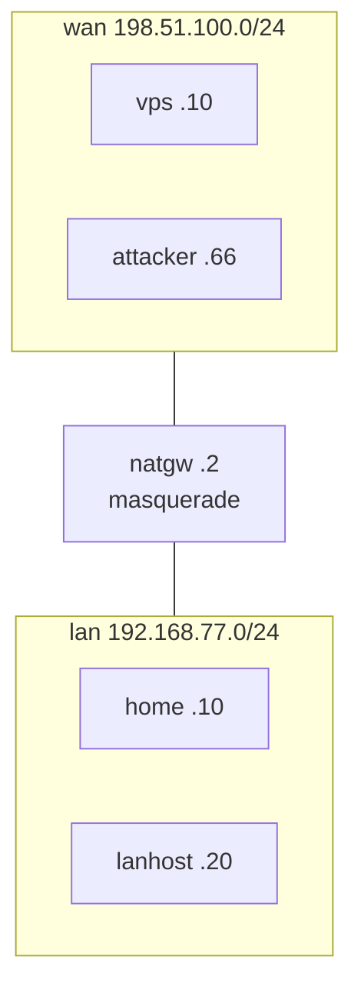

# Testing

meshly is tested in four layers: unit tests with an in-memory fake kernel,
fuzz tests of every parser that reads untrusted input, fault injection
inside real transactions, and integration tests with real packets between
Linux network namespaces. This document lists what each layer covers, how to
run it, and, at the end, what has **not** been verified. Background:
[architecture.md](architecture.md), [threat-model.md](threat-model.md),
[firewall.md](firewall.md).

## Quick reference

| Command | What it runs | Needs |
|---|---|---|
| `make vet` | `gofmt`, `go vet` for Linux, with and without `meshly_faultinject` | Go |
| `make test` | `go test ./...` | Go |
| `make fuzz` | each fuzz target for `FUZZTIME` (default 30s) | Go |
| `make integration` | `go test -tags integration ./test/integration/...` | Linux kernel with WireGuard and nf_tables, Docker, Go |
| `make dist` | reproducible release build for amd64 and arm64 | Go, `release-key.pub` |

## Unit tests

`go test ./...` runs on any OS with Go. Tests that need Linux-only code
(`internal/cli/flow_linux_test.go`) are built only on Linux.

| Package | Covers |
|---|---|
| `internal/model` | Validation of every configuration field (names, interface names, CIDRs, addresses, endpoints incl. IPv6 notation, ports, MTU, keepalive, mark, keys), rule parsing, address allocation, conflicts with local prefixes. |
| `internal/store` | Directory and file modes and ownership, refusal of symlinks and non-regular files, atomic writes, bounded reads of untrusted files, config history pruning, keys (never printed, wiped), runtime state and the marker of an open invite. |
| `internal/journal` | Append/read, torn and corrupt lines after a crash, incomplete operation detection, rotation (never with an open operation). |
| `internal/pairing` | Invite codes: round trip for IPv4 and IPv6 endpoints, tolerant input (whitespace, letter case), the start of a code read on across lines and garbage refused at once, every refusal (prefix, base32, length, family, checksum, fields, another version, expiry with clock skew), expiry truncated to seconds; derived keys against fixed test vectors, and wiping. Messages: the exchange between both sides, size limit and framing, strict JSON (unknown, duplicate or non-canonical keys), a hostile peer on either side, refusal to send an invalid message. The in-memory network used by the CLI tests, whose connections report the addresses of both ends as a kernel's do. |
| `internal/nft` | Deterministic rendering and policy hash, rule shapes (default deny, no forwarding, DNAT refusal, IPv4 only, no `established` shortcut inbound), lockdown table, rejection of unsafe input, ownership marker round trip, analysis of foreign rulesets (ban lists: needing no integration, checked against the VPN network until a peer is known, reporting banned peers and endpoints; a set with a range over the VPN network, an anonymous set and an allow list are not ban lists); an exclusive port (the pairing port of an invite) dropped for anything but its peer through the interface, loopback included, with the table otherwise unchanged and no such rule without one. |
| `internal/engine` | Bring-up order (firewall first), tear-down order (traffic path first), idempotency, ownership conflicts, backward rollback (also after the config was saved), forward completion, safe mode when rollback fails, recovery in both directions, drift, endpoint hints; meshly's rule in the iptables chains (first, right after the table, only where a chain may drop; idempotent; removed, misplaced and duplicate rules repaired; rolled back with the step; removed in tear-down; kept in safe mode, whose table marks no transport); temporary overlays (an extra peer with a preshared key, extra allow entries that only their peer may reach, a temporary private key) never saved, the table of the saved configuration again once the overlay is removed, the saved configuration restored when an overlay fails, the preshared key cleared when a peer is updated in place. Uses `internal/engine/enginetest`. |
| `internal/preflight` | UFW/firewalld/fail2ban/legacy iptables detection, a banned peer as a warning with the command that lifts the ban, local port parsing and listen port selection, conflict checks, profile selection and firewall evaluation (iptables chains reported, not refused, and not part of the profile). |
| `internal/systemd` | Unit rendering (unsafe executable paths refused), installation incl. networkd/NetworkManager files and the nftables drop-in, uninstall, exact `systemctl` argument vectors, state parsing. |
| `internal/upgrade` | Release key parsing, signed message format, signature verification, `SHA256SUMS` parsing (single version), version comparison, download over a local test server with tampered files, URL policy (HTTPS only, loopback for tests), binary install and rollback. |
| `internal/cli` (Linux) | Full two-node flow (`init` → `invite` + `join` → `allow`/`deny`/`revoke`) on two fake kernels joined by an in-memory network, absence of private keys, the invite code and the keys derived from it in all output, the journal, the configuration and `status`, exit codes (including 7 rolled back and 8 safe mode, and leaving safe mode with `start`). Pairing: how the code is read (prompt, stdin, broken across lines, refused as an argument), the name from the host name, preflight before any contact, every answer of the invite by state, no answer to a connection from another address than the joining node's, a `welcome` that does not match the code, name taken, code used, no answer, cancel, hang-up, broken pipe and expiry on both sides, a confirmation at the deadline, an unconfirmed join undone on both sides, the open invite in `status` and `doctor` (also until a joined node's confirmation deadline past the code's expiry), a killed invite closed by the next command, leftovers of a crashed join removed. |

`internal/nft/testdata/nft-1.0.6` and `nft-1.0.9` hold `nft -j list ruleset`
output captured from real nftables 1.0.6 (Debian 12) and 1.0.9
(Ubuntu 24.04): empty ruleset, host firewalls with and without the
integration rule, a misplaced rule, compatible accept rules, named sets,
Docker, iptables-nft, UFW 0.36.2 enabled with and without meshly's rule in
its chains, fail2ban 1.0.2 with its nftables actions (sshd and recidive
jails, IPv4 and IPv6 bans; also with the peer banned), firewalld,
flowtable/netdev, and meshly's own table. `nft-1.1.3` (Debian 13, iptables
1.8.11, UFW 0.36.2, fail2ban 1.1.0) holds only the UFW and fail2ban
captures.

To run the Linux-only CLI tests from macOS, build the test binary and run it
in a Linux container:

```
GOOS=linux GOARCH=arm64 go test -c -o bin/cli.test ./internal/cli
docker run --rm -v "$PWD/bin:/t" debian:12 /t/cli.test -test.v
```

## Fuzzing

`make fuzz` (set `FUZZTIME`, e.g. `make fuzz FUZZTIME=5m`) runs:

| Target | Input |
|---|---|
| `internal/pairing` `FuzzParseCode` | Invite codes as pasted; a code that parses must parse again, unchanged, from its own text form |
| `internal/pairing` `FuzzReadRequest` | Requests on the inviting node's pairing port; what is accepted must be valid and carry exactly one body |
| `internal/model` `FuzzParseRule` | `allow`/`deny` arguments |
| `internal/model` `FuzzParseEndpoint` | `IP:PORT` endpoints |
| `internal/model` `FuzzParseEndpointOrAddr` | Endpoints with an optional port; agrees with `FuzzParseEndpoint` where both accept |
| `internal/model` `FuzzParseCIDR` | VPN network CIDRs |
| `internal/nft` `FuzzParseRuleset` | `nft -j list ruleset` JSON, seeded with the fixtures; analysis must not panic |
| `internal/store` `FuzzDecodeConfig` | `meshly.json` |

## Fault injection

Binaries built with `-tags meshly_faultinject` read
`MESHLY_FAULT="<point>=<error|crash>[,...]"`. `error` makes the point return
an error; `crash` exits the process immediately with status 137 and no
cleanup, which stands in for `kill -9` or power loss. Release builds compile
every point to a no-op and ignore the variable.

| Point | Location |
|---|---|
| `tx:after-begin` | after the `begin` record was written |
| `step:<name>` | before each plan step (`firewall.apply`, `link.create`, `link.sysctl`, `link.address`, `wireguard.configure`, `link.up`, `routes.sync`, `link.down`, `link.delete`, `firewall.remove`, …) |
| `tx:before-verify` | after all steps |
| `tx:before-save` | before saving the configuration (backward operations only) |
| `tx:before-commit` | before the `commit` record |
| `tx:rollback` | at the start of rollback or retry (used to force safe mode) |

The same build reads `MESHLY_TEST_RELEASE_URL` so that upgrade tests can use
a local release server. The integration tests use this build.

## Integration tests

`make integration` builds a fault-injection binary, a test file server and
the container images, then runs each test in its own lab. Every node is a
privileged Docker container with its **own network namespace**; meshly never
runs on the host's network stack. Containers and networks carry the label
`meshly-it=1` and are removed afterwards (set `MESHLY_IT_KEEP=1` to keep the
containers of a failed test). `MESHLY_IT_DISTROS=deb12,u2404` selects the
distributions (default: both).

Topology of each lab:



Images: `node.Dockerfile` on Debian 12 and Ubuntu 24.04 (nftables,
iptables, UFW, fail2ban, iproute2, wireguard-tools, conntrack, netcat), and
`systemd.Dockerfile` on Debian 12 with systemd as PID 1 (also with
iptables and UFW). UFW and fail2ban are installed but run only in the
tests that need them. A container
restart stands in for a reboot: the network namespace, interface and all
nftables tables are recreated empty, and systemd boots again.

| Test | What it shows with real packets |
|---|---|
| `TestPolicy` (Debian 12 and Ubuntu 24.04) | Handshake through NAT; nothing is reachable in either direction before `allow`; `allow` opens exactly one port, protocol and direction (TCP and UDP; ping needs its own rule); an outside host routing to the VPN address over the public network gets nothing; `revoke` closes all access and removes the peer's key, route and rules. |
| `TestDenyStopsEstablishedFlow` | A running TCP stream (ESTABLISHED in conntrack) receives no further data after `deny`; new connections fail. |
| `TestCompromisedPeerContained` | With root on the VPS turned hostile (meshly table removed, WireGuard allowed-ips and routes widened): no access to the home LAN, to home's LAN address, to ports without a rule, with a spoofed VPN source address (from the VPN and from the LAN), or through Docker-style DNAT and redirect; forwarding stays blocked even after `forwarding=1` is set on the interface, and the check repairs that sysctl. |
| `TestForeignStatePreserved` | Foreign nftables tables, routes, interfaces and public SSH are byte-for-byte unchanged across `init`, `allow`, `set mtu`, `stop`, `start`, `revoke` and `reset`; `reset` leaves no meshly objects. |
| `TestNATAndIdle` | With 30 s UDP conntrack timeouts on the NAT gateway, the link works after 70 s idle, and again after all NAT mappings are flushed. |
| `TestIdempotency` | Repeating `init`, `allow` and `start` leaves the kernel state (interface, routes, WireGuard, nftables) exactly as before; a repeated `deny` has nothing to remove. |
| `TestConcurrentOperations` | Parallel commands are serialised by the lock; `status` works while they run. |
| `TestPairing` | `invite` and `join` pair the nodes; the inviting node has only the joined node's key as a peer, and there is no drift on either node. The invite code and the keys derived from it are not in the journal, the process list, `status`, `doctor` or `logs`; `status` and `doctor` show an open invite without an alarm; key files are `0600` in a `0700` directory, and no private key appears in output or readable files. |
| `TestPairingRefusals` | A damaged code is refused (exit 4) and leaves nothing behind; a code given as an argument is refused (exit 2); a used code gets no answer (exit 13 within 45 s); an invite expires (exit 13) with nothing left of it; a code just past its expiry gets no answer (13), and one beyond the clock-skew allowance is refused as expired (4). |
| `TestPairingNothingExposed` | While an invite waits, the only new socket is TCP 51820 on the VPN address; the public address does not accept it; a host with a route to the VPN address through the VPS is dropped by `guard_pre` (its counter grows), while another address of the VPS on the same route is reachable; no new UDP socket appears. |
| `TestPairingClosedToLocalUsers` | While an invite waits, a connection to the pairing port on the VPS's VPN address fails as `nobody` and as root, and the invite's rule in `guard_in` counts the dropped packets; with that rule deleted, the same connection succeeds (so the rule alone closes the port to local processes), and a `hello` over loopback gets no answer from the listener while the invite keeps its temporary peer; Ctrl+C leaves the kernel state as before. |
| `TestPairingUDPBlocked` | With UDP to the WireGuard port blocked, `join` exits 13 within 45 s and says why, changing nothing; the same code works once the path is open. |
| `TestPairingCleanup` | Ctrl+C on `invite` (exit 10) leaves the kernel state as before; after `kill -9`, the temporary peer and the marker are still there until `meshly service check` removes them, journals `closed: interrupted` and leaves no drift. |
| `TestEndpointDetected` | Without `--endpoint`, `init` on the vps (default route on the wan) advertises its public address with port 51820, and `init` on home (private address behind NAT) advertises none. |
| `TestFaultsInit` | `init` with `error` and `crash` at every point leaves either nothing or the complete, verified configuration after recovery. |
| `TestFaultsAllow` | An interrupted `allow` is either fully in effect (config and packets) or not at all; with a failing rollback, safe mode removes the interface, the lockdown table admits no peer, and `start` restores the link without the failed rule. |
| `TestFaultsReduce` | Interrupted `deny`, `stop` and `revoke` are completed by recovery; access is closed afterwards in every case. |
| `TestFaultJoin` | A crash of `join` while it configures WireGuard is cleaned up on the joining node; the inviting node undoes the join that was never confirmed and keeps waiting, and a second `join` with the same code succeeds. |
| `TestUnsupportedFirewalls` | firewalld, legacy iptables rules and an iptables-nft `mangle` chain that drops each stop `init` and `init --dry-run` with exit 3 and a message naming the cause, with no change to the host. |
| `TestUFW` (Debian 12 and Ubuntu 24.04) | Real UFW enabled on both nodes (default deny incoming, SSH allowed on the vps) with no rule for meshly: `init` names the chains it integrates; pairing and an allowed service work; SSH, open in UFW, is not reachable through the VPN without a meshly rule; the application port stays closed publicly and public SSH stays open; UFW's rules are unchanged; `ufw allow`, `reload`, `disable` and `enable` keep meshly's rule first with no drift; after `iptables-restore` without it the VPN service is closed and `status` shows `MISSING` until the check repairs it; `stop` removes the rule, `start` brings it back, `reset` leaves UFW as it was. |
| `TestIptablesHost` | Hand-written iptables rules with `policy DROP` on `INPUT` and nothing for the WireGuard port: pairing and an allowed service work, SSH is not reachable through the VPN, public ports are unchanged; meshly's rule is first in `INPUT` and absent from the empty `OUTPUT`; a rule inserted above it is moved below by the check; `reset` leaves `iptables-save` exactly as before. |
| `TestFail2ban` (Debian 12 and Ubuntu 24.04) | Real fail2ban with its nftables actions and an outside address banned on both nodes: `init`, `invite` and `join` succeed without a firewall warning. A ban of the peer's VPN address rejects SSH through the VPN but leaves another allowed port open; `allow` and `restart` still succeed and warn with `fail2ban-client unban`, as does `doctor`; after the unban SSH works and the warning is gone; `reset` leaves fail2ban's table as it was. |
| `TestFail2banIptables` | fail2ban with its iptables actions (the default on Debian 12): pairing works, meshly's rule is first in `INPUT`, and a ban of the peer does not reach traffic meshly accepted. |
| `TestNativeNftablesProfile` | A host firewall with `policy drop`: refused without the integration rule and with a misplaced one; works with it; the application port stays closed publicly and public SSH stays open; SSH is not reachable through the VPN without a rule; deleting the meshly table closes what meshly opened (fail-closed) until the check repairs it; with the integration rule removed, `allow` is refused, `deny`/`revoke` still work, and `doctor` exits 12 with the rule to add. |
| `TestSystemdLifecycle` | Units enabled and active after pairing; after a reboot the link and an allowed service come back, with the firewall table installed before the interface; `systemctl stop/start/restart meshly` leave the configuration unchanged; `meshly stop` survives a reboot; an operation crashed before a reboot is recovered at boot and does not take effect; `nftables.service` start, reload and restart with `flush ruleset` keep the meshly table and the service reachable; the check timer is scheduled, and `meshly-check.service` restores a deleted table; after safe mode, `meshly-check.service` brings the link back from the saved configuration without the failed change. |
| `TestSystemdUFW` | With UFW enabled, after a reboot UFW and meshly are active, meshly's rule is first and the allowed service is reachable. A unit named `netfilter-persistent.service` that runs `iptables-restore` (a stand-in for the real package, which cannot be installed next to UFW) removes the rule on restart, and meshly's drop-in puts it back at once (a `service-reload` that integrates the chains is journaled). `systemctl restart ufw` keeps the rule first. `reset` warns when `/etc/iptables/rules.v4` still holds the rule and removes it from the kernel. |
| `TestInstallUpgradeUninstall` | `install.sh` installs from a local release tree and refuses a tampered `SHA256SUMS` or binary; `upgrade --check`, `upgrade` (needs `--yes` non-interactively), `.prev` kept, repeated upgrade is a no-op; the service is reachable after the upgrade; a downgrade needs `--force` (exit 5); a modified `SHA256SUMS` (signature mismatch) is refused (exit 1) without changing the binary; `reset` removes units, kernel objects and state without touching foreign state. |

A full run takes about 9 minutes on an Apple-silicon laptop with OrbStack.
`MESHLY_IT_SHORT=1` skips the slow parts: `TestNATAndIdle`, `TestFaultJoin`
and the expiry checks of `TestPairingRefusals`, which wait for a real invite
to expire.

## Continuous integration

`.github/workflows/ci.yml` runs on pushes to `main` and on pull requests:

- `lint`: `gofmt`, `go mod tidy -diff`, `go vet` (plain, `meshly_faultinject`,
  `integration`), `shellcheck scripts/*.sh`;
- `test`: `go test -race ./...` and the fault-injection build, on
  `ubuntu-24.04` (amd64) and `ubuntu-24.04-arm` (arm64);
- `fuzz`: every fuzz target for 15 s;
- `build`: `make dist` for both architectures, uploaded as an artifact;
- `integration`: `make integration` on `ubuntu-24.04` after loading the
  `wireguard` and `nf_tables` modules.

`.github/workflows/release-verify.yml` runs when a release is published (or
manually for a tag). It verifies the Ed25519 signature of `SHA256SUMS` with
`release-key.pub` from the repository, using `openssl` as `install.sh` does,
checks the released files against `SHA256SUMS`, rebuilds the release from the
tag and requires identical checksums.

## Reproducible builds

Release builds use `CGO_ENABLED=0`, `-trimpath`, `-buildvcs=false`,
`-buildid=` and fixed `-ldflags`, with the Go version from `go.mod`. While
preparing 0.0.1, `make dist VERSION=0.0.1` was run on macOS (arm64) and in a
`golang:1.27.2` Linux container, and the two `SHA256SUMS` files were
identical. To check a release yourself:

```
git checkout v0.0.1
make dist VERSION=0.0.1 COMMIT=$(git rev-parse --short=12 HEAD)
gh release download v0.0.1 --dir /tmp/meshly-v0.0.1
diff /tmp/meshly-v0.0.1/SHA256SUMS dist/SHA256SUMS
```

0.0.1 was built before `-buildvcs=false`: Go stamped into it whether the
checkout had changes, so rebuild it from a checkout where `git status
--porcelain` prints nothing (untracked files count too).

## Not verified

The following is not covered by the tests above. Treat these areas with more
care, and please report results from real systems.

- **Containers, not virtual machines.** All integration nodes share one host
  kernel (OrbStack's Linux kernel locally, the runner's kernel in CI). Network
  namespaces give each node its own interfaces, routes, conntrack and
  nftables, but kernel versions and module loading are not varied.
- **No real reboot.** A container restart recreates the network namespace and
  boots systemd, but no kernel, initramfs or real boot ordering with
  networkd/NetworkManager and cloud-init is involved.
- **firewalld is simulated.** Detection is tested with firewalld's pid file and
  with captured rulesets in unit tests. Real firewalld was not installed.
- **netfilter-persistent is simulated.** The real `iptables-persistent`
  package conflicts with UFW and is not installed; a unit with its name runs
  `iptables-restore`. `iptables-restore` by hand is tested with the real tool.
- **NetworkManager and systemd-networkd** are not running in the test images;
  only the installation of the "unmanaged" files is unit-tested.
- **Upgrade rollback after a failed service start** (restore `.prev`, restart,
  exit 7) is not integration-tested. Binary installation and rollback are
  unit-tested; the restart path is not.
- **Automatic firing of the check timer.** The test checks that the timer is
  scheduled and starts `meshly-check.service` by hand.
- **Distribution coverage.** Only Debian 12 (nftables 1.0.6) and Ubuntu 24.04
  (nftables 1.0.9). `TestPolicy`, which pairs the nodes with `invite` and
  `join`, `TestUFW` and `TestFail2ban` run on both; all other integration tests, including
  all systemd tests, run on Debian 12 only. Debian 13 (iptables 1.8.11,
  nftables 1.1.3) is covered only by the UFW and fail2ban captures above; by hand, meshly's
  rule there shows in `iptables -S`, survives `ufw reload`, `disable` and
  `enable`, and `iptables-save | iptables-restore`.
- **Two nodes racing for one invite.** The `used` answer to a second node
  that reaches the invite before it closes is tested only on fake kernels
  (`TestJoinCodeUsed`). With real packets, the second node tries only after
  the invite has closed, and gets no answer (exit 13).
- **Architecture coverage.** The integration suite was run locally on arm64.
  amd64 is covered only by the CI workflow.
- **IPv6 transport.** Validation accepts IPv6 endpoints (`[2001:db8::1]:51820`),
  and invite codes carry them, but no test runs WireGuard or pairing over
  IPv6. Learned endpoint hints are used only for IPv4. IPv6 inside the VPN
  is not supported by design.
- **Real networks.** One Linux masquerading NAT with short timeouts; no
  carrier-grade or symmetric NAT, no real cloud firewalls or security groups,
  no path-MTU problems.
- **Docker** is simulated with equivalent nftables DNAT/redirect rules and a
  captured Docker ruleset; a real Docker daemon on a meshly host was not
  tested.
- **install.sh over GitHub.** Tests serve the release tree over local HTTP
  (`MESHLY_BASE_URL`); downloads from github.com over HTTPS are not part of
  the suite.
- **Long-term behaviour and performance** (days of uptime, throughput, CPU
  cost of the per-packet policy) were not measured.
